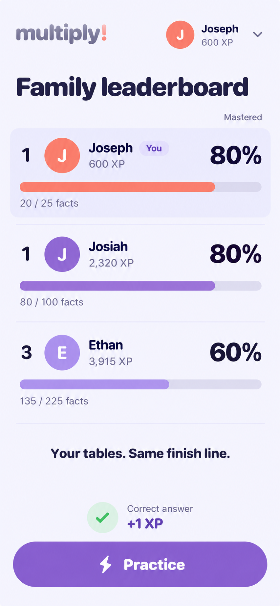
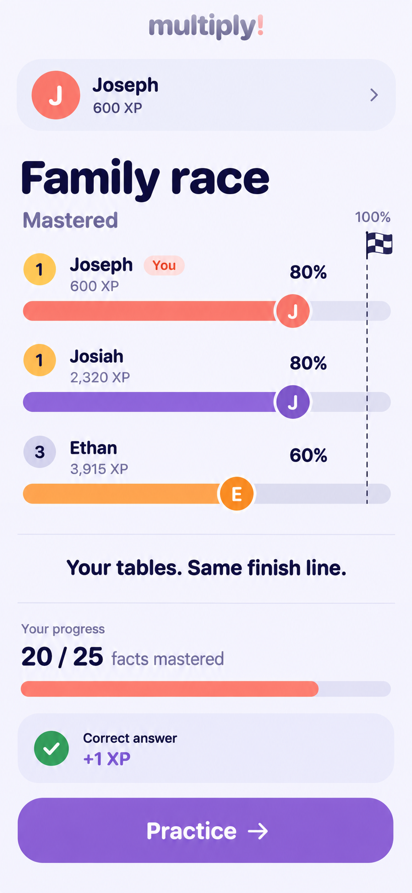
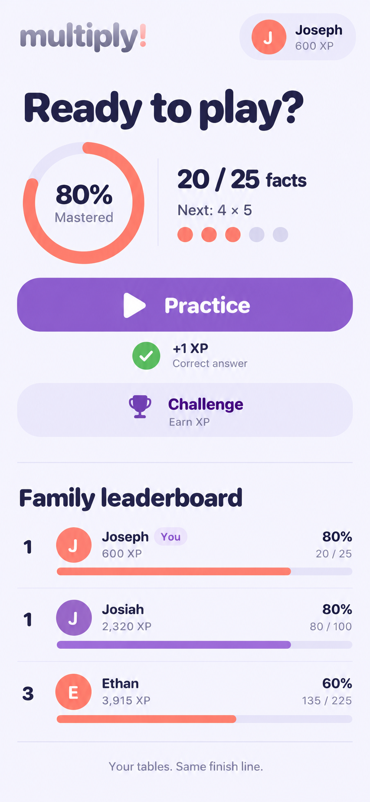

# Gamification visual study

Planning concepts generated with the built-in Image Gen tool from the supplied Multiply screenshot and the [gamification plan](../../gamification-plan.md). These are static mockups, not implemented or browser-tested screens. The screen order below matches their display order in the conversation.

Each concept uses the same illustrative data: Joseph has 600 XP and 20/25 facts mastered; Josiah has 2,320 XP and 80/100; Ethan has 3,915 XP and 135/225. The two players at 80% share first place; the player at 60% is third regardless of XP.

## 1. Aligned progress

## 2. Shared finish line

## 3. Personal progress

## Implementation notes

The plan is authoritative for scoring and behavior. Generated geometry and typography are illustrative. Measure actual progress fills, verify accessible type at 320px, and make the header persistent in implementation. The response dots in the third concept must not be interpreted as three correct answers automatically proving a fact is nearly mastered; the mastery evidence and accuracy rule still applies.

The first layout is the recommended starting point for the full leaderboard. The third shows how the same model can fit the activity home, without an expanded level catalog.

Source: [current activity screenshot](current-activity.jpg). Generation brief: [prompt set](prompts.md).
